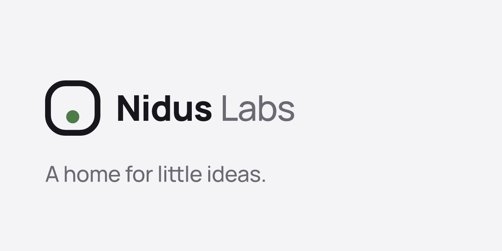

# Nidus Labs assets

> Part of the Nidus Labs workspace (`~/Work/personal/niduslabs`). Start with the workspace guide `../AGENTS.md` and `../STATUS.md`.

The studio's logo, icons and social images. *Nidus* is Latin for "nest": the mark is an app tile with a seed settling into it.

**A home for little ideas.**



## What's here

| Folder | Files | Use |
| --- | --- | --- |
| `logo/` | `mark`, `lockup` (mark + wordmark), each `on-dark`, `mono-black`, `mono-white` (SVG); PNGs in `logo/png/` | Anywhere the logo appears. Prefer the SVG. |
| `avatar/` | `avatar.svg`, `avatar-1024.png`, `avatar-512.png` | GitHub, npm, and other profile pictures. Safe for a circle crop. |
| `web/` | `favicon.svg`, `favicon.ico` (16, 32, 48), `apple-touch-icon.png`, `icon-192.png`, `icon-512.png`, `icon-maskable-512.png` | Websites and web app manifests. |
| `social/` | `og-image.png` (1200×630), `github-social-preview.png` (1280×640) | Link previews and the GitHub social preview. |
| `stores/` | `google-play-header.png` (4096×2304), `google-play-icon-512.png` | The Google Play developer page. 24-bit PNGs, since Play refuses transparency. |
| `apps/splito/` | `google-play-icon-512.png`, `google-play-feature-graphic.png` (1024×500) | Splito's store listing: its icon redrawn from the app's shapes, and its name in Plus Jakarta Sans, the app's typeface. |
| `apps/drop/` | `icon.svg`, `icon-small.svg`, `Drop.iconset/` (every macOS size), `Drop.icns` | Drop's app icon, "The Slot": an app tile carrying the Nidus mark drops into a glowing moss slot, on Apple's 1024 grid. The small cut is used at 32 px and below. `Drop.icns` is packed from the iconset with `iconutil -c icns apps/drop/Drop.iconset -o apps/drop/Drop.icns` after `npm run build`. |
| `apps/pane/` | `icon.svg`, `icon-32.svg`, `icon-16.svg`, `png/` (1024, 512, 256, 128), `Pane.iconset/`, `Pane.icns`, `AppIcon.appiconset/`, `favicon.svg`, `favicon-32.png` | Pane's app icon, "Phone behind glass": a phone with a moss screen behind a clear tilted pane of glass, the Nidus seed on the glass, on a paper tile on Apple's 1024 grid. Drawn in `scripts/pane-icon.mjs`. 32 px and 16 px have their own pixel-grid cuts (16 drops the seed). `npm run build` also packs `Pane.icns` (on a Mac). The favicon is the 32 px cut on a tile that fills the canvas. |
| `tokens.json` | Brand colours, byline and wordmark type, plus the design language's shared tokens: spacing, type scale, radii, colour roles (light, dark, Increase Contrast), motion and component sizes | The single source, in the Design Tokens (DTCG 2025.10) format. See Design tokens below. |
| `dist/tokens/` | `ThemeTokens.swift`, `tokens.css`, `tokens.ts`, `tokens.kit.json`, `splito.ts` | Generated from `tokens.json` for Swift, the web, React Native and the kit page, plus Splito's own palette. Never edit. |

## Colours

| Token | Hex | Use |
| --- | --- | --- |
| `ink` | `#17161C` | The tile, text, dark grounds |
| `paper` | `#F4F4F6` | Light grounds; the tile on dark |
| `moss` | `#4F7A4A` | The seed, on light |
| `mossOnDark` | `#8DBB82` | The seed, on dark |
| `muted` | `#6B6A73` | "Labs" and secondary text, on light |
| `mutedOnDark` | `#B9B8C2` | The same, on dark |

The mark is ink first so it sits beside any app's own colours. Moss is used only for the seed.

## Wordmark

Manrope: **Nidus** in ExtraBold (800), Labs in Medium (500), tracking −0.02em. The SVGs have the text outlined, so they need no font installed.

## Using the mark

- Keep clear space around it of at least the seed's diameter.
- Use the regular mark from 48 px up. Below that, use `web/favicon.svg` or `favicon.ico`: a heavier cut drawn for small sizes.
- On photos or colour, use a mono version.
- Don't recolour the seed to anything but moss (or the mono colour), stretch the tile, or set the wordmark in another typeface.

## Design tokens

`tokens.json` is the one source of the studio's design values, in the [Design Tokens Format Module 2025.10](https://www.designtokens.org/tr/2025.10/format/). How apps use it: `../docs/design-language.md` and `../design/MIGRATION.md` in the workspace repo.

- **Groups:** `color.brand`, `color.role` (named by job), `font`, `space`, `type`, `radius`, `border`, `opacity`, `shadow`, `motion`, `size` (component sizes off the spacing scale) and `app.<name>` (values one app owns).
- **Modes:** a colour's `$value` is light. Dark and the two Increase Contrast values sit in `$extensions["dev.niduslabs.modes"]`. A mode left out falls back: `darkContrast` to `dark`, the others to light.
- **Springs** are two numbers, `response` and `damping` (SwiftUI's damping fraction). The TypeScript output adds stiffness, damping and mass.
- **An app with its own language** (Splito) marks its group with `$extensions["dev.niduslabs.outputs"]`. The shared outputs leave it out; its own emitter (`scripts/tokens/emit-splito.mjs`) writes `dist/tokens/splito.ts`. Shadows there may carry a dark mode too.
- **Brand text** (name, byline, app names) is in the root `$extensions["dev.niduslabs.brand"]`; `scripts/tokens/brand.mjs` hands the artwork build the plain shape it reads.
- **Outputs:** `npm run build:tokens` writes `dist/tokens/`. `npm run check:tokens` fails when a committed output is stale. The generator (`scripts/tokens/`) has no dependencies.

## Rebuilding

Everything is generated from `scripts/build.mjs` and `tokens.json`; change those, never the outputs by hand.

```sh
npm install
npm run build
```

The build outlines text from the Manrope and Plus Jakarta Sans files in `scripts/fonts/` (both SIL Open Font License; see the `OFL-*.txt` files there) and renders the PNGs with resvg.
